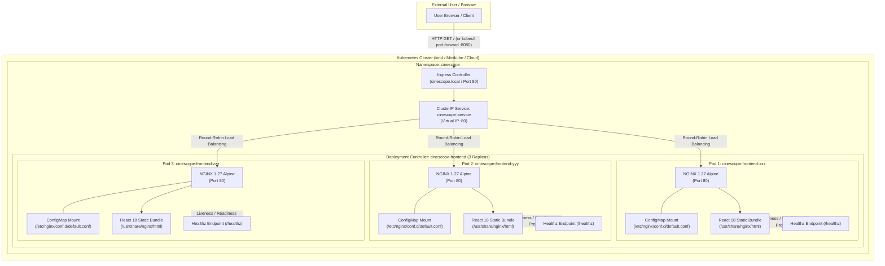
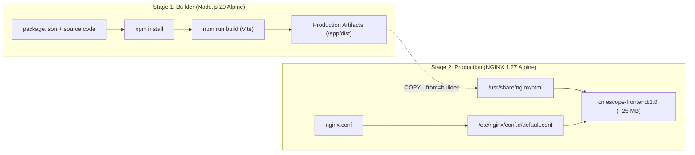

# 🎬 CineScope Architecture & DevOps Design Document

CineScope is a modern, responsive, cinematic movie discovery and review landing page built as a cloud-native single-page application (SPA). This document outlines the end-to-end technical architecture across the frontend, containerization, web server, and Kubernetes orchestration tiers.

---

## 1. High-Level System Architecture

The following Mermaid diagram illustrates the end-to-end request flow from the end user to the containerized React application running inside a Kubernetes cluster:



---

## 2. Layer-by-Layer Architectural Breakdown

### 2.1. Frontend Tier (React 18 + Vite)
- **Framework & Tooling**: Built with **React 18** and **Vite** for blazing-fast bundling and minimal build output (~180 KB JS, ~20 KB CSS).
- **Design Paradigm**: Dark cinematic aesthetic featuring glassmorphism, responsive grid layouts, Google Fonts (`Outfit` for display headings and `Inter` for crisp body copy), gold/amber star ratings (`#f59e0b`), crimson accents (`#e11d48`), and subtle micro-animations.
- **Pure Frontend Architecture**: No Node.js backend APIs, MongoDB, or external database required.
  - **Dataset (`src/data/movies.js`)**: 14 curated iconic films across diverse genres with high-resolution posters, backdrops, ratings, synopsis, critic reviews, and audience commentary.
  - **Component Hierarchy**:
    - `Navbar`: Sticky brand header with film icon, navigation shortcuts, and interactive Watchlist count badge.
    - `Hero`: Immersive featured movie showcase with Ken Burns backdrop animation, rating badge, and review triggers.
    - `SearchBar`: Real-time instant filtering with clear button and multi-mode sorting (Highest Rated, Newest, Title).
    - `GenreFilter`: Pill-style genre filters with active state indicators and count statistics.
    - `MovieList`: Responsive grid with stagger transitions and animated empty state.
    - `MovieCard`: Poster card with network error image fallback, rating chip, favorite toggle, and duration pill.
    - `MovieModal`: Accessible dialog with backdrop blur, full critic breakdown, verdict quotes, and an interactive review submission form.
    - `Footer`: Platform credits, technology stack highlights, and DevOps metadata.

---

### 2.2. Web Server Tier (NGINX Alpine)
- **Base Image**: Lightweight `nginx:1.27-alpine` (~23 MB image size).
- **Single Page Application (SPA) Fallback**:
  ```nginx
  location / {
      try_files $uri $uri/ /index.html;
  }
  ```
  Prevents HTTP 404 errors when navigating client-side routes or refreshing deep links.
- **Health Endpoint (`/healthz`)**:
  ```nginx
  location = /healthz {
      access_log off;
      default_type text/plain;
      return 200 "healthy\n";
  }
  ```
  Used by Docker `HEALTHCHECK` and Kubernetes `livenessProbe` / `readinessProbe` to verify container vitality without polluting access logs.
- **Performance Optimizations**:
  - Gzip compression enabled for static text, HTML, CSS, JavaScript, and JSON.
  - 1-year immutable caching headers for static assets (`/assets/*.js`, `*.css`).
- **Security Headers**:
  - `X-Frame-Options: SAMEORIGIN` (prevents clickjacking)
  - `X-Content-Type-Options: nosniff` (prevents MIME type sniffing)
  - `X-XSS-Protection: 1; mode=block` (cross-site scripting protection)

---

### 2.3. Containerization Tier (Docker Multi-Stage Build)

The build utilizes a **two-stage Dockerfile** to decouple the development toolchain from the production runtime:



- **Benefits**:
  - No Node.js runtime, compilers, or `node_modules` in the final image.
  - Image size is reduced from >600 MB to **under 30 MB**.
  - Dramatically shrinks the attack surface for container vulnerability scanning.

---

### 2.4. Kubernetes Orchestration Tier (`k8s/`)

| Kubernetes Resource | File | Purpose |
| :--- | :--- | :--- |
| **Namespace** | `k8s/namespace.yaml` | Isolates CineScope workloads into dedicated namespace `cinescope`. |
| **ConfigMap** | `k8s/configmap.yaml` | Decouples NGINX configuration from the image; allows instant route tuning without rebuilds. |
| **Deployment** | `k8s/deployment.yaml` | Manages 3 replica Pods, rolling updates, health probes, and resource bounds. |
| **Service** | `k8s/service.yaml` | Internal `ClusterIP` virtual IP providing stable round-robin load balancing across Pods. |
| **Ingress** | `k8s/ingress.yaml` | Optional HTTP ingress entry point mapping `cinescope.local` to `cinescope-service:80`. |
| **Kustomization** | `k8s/kustomization.yaml` | Bundles and manages all manifests declaratively with unified labels. |

#### Key Kubernetes Resilience Features:
1. **High Availability (3 Replicas)**: If any node or container fails, the remaining Pods immediately serve traffic with zero user disruption.
2. **Rolling Updates (`maxSurge: 1`, `maxUnavailable: 0`)**: Upgrades deploy new pods before terminating old ones, ensuring 100% uptime.
3. **Liveness Probe**: Restarts the container if NGINX locks up or stops responding to `/healthz`.
4. **Readiness Probe**: Withholds traffic from the Service load balancer until the Pod is fully ready to serve traffic.
5. **Resource Constraints**:
   - `requests.cpu: 50m`, `requests.memory: 64Mi`
   - `limits.cpu: 250m`, `limits.memory: 128Mi`
   - Prevents noisy-neighbor starvation on shared Kubernetes nodes.
6. **Security Hardening**:
   - `allowPrivilegeEscalation: false`
   - `capabilities: drop: ["ALL"]`

---

## 3. End-to-End Request & Traffic Lifecycle

1. **Client Request**: The browser requests `http://localhost:8080/`.
2. **Kubernetes Port-Forward / Ingress**: Traffic hits the cluster boundary.
3. **ClusterIP Service**: Resolves `cinescope-service` DNS and balances the connection across healthy Pods marked ready by `readinessProbe`.
4. **Pod Container**: Container receives the TCP connection on port `80`.
5. **NGINX Engine**: Matches the route. If requesting static files (`.js`, `.css`), NGINX serves them with gzip and cache headers. If requesting an unknown path, NGINX serves `index.html` via `try_files` for React client-side handling.
6. **Health Checking**: Kubernetes kubelet sends background `GET /healthz` requests every 10 seconds. NGINX returns `200 healthy\n` instantaneously without touching disk or generating access log noise.
